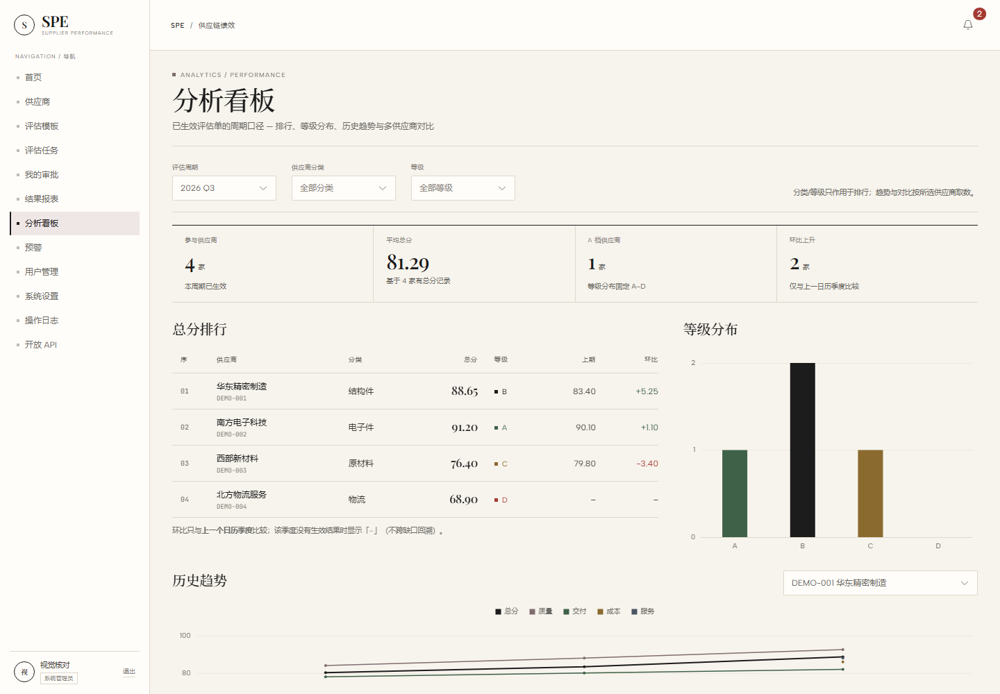
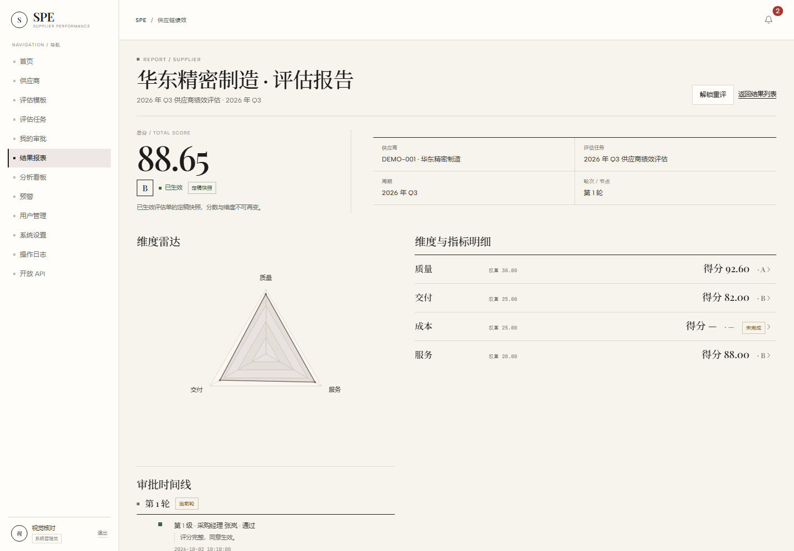

# SPE — 供应商绩效评估系统

SPE（Supplier Performance Evaluation）是一个面向采购与质量团队的供应商季度绩效评估系统：从模板配置、任务发布、按维度协同评分、多级串行审批，到结果报告、分析看板与开放 API，覆盖完整闭环。

> 定位：**学习 / 演示项目**。数据模型按中型规模设计（50 用户、500 供应商、季度评估），默认演示口令是公开的，不能直接当作生产系统部署。





## 当前状态

- **M1～M6 全部达成，并补齐「预警 → 整改任务 → 下期验证」闭环**：身份与档案、模板版本、评估流程、审批定级、分析/预警、整改闭环、开放 API。
- 后端 **443** 个测试、前端 **183** 个 Vitest 用例、真实全栈 **31** 个 Playwright e2e、像素级视觉回归 **13 个用例 / 15 张基线**。
- `pnpm lint` 0 warning、`pnpm build` 通过；应用依赖 OSV **0/0**，MySQL 8.4.13 的 NVD 与 Oracle Linux errata 已核对。
- 视觉基线：**Editorial Ledger**（纸面、墨色、衬线标题/数字、1px 规则线），覆盖全部页面与移动端菜单。
- 代码在 `main`；后端/前端/端到端/视觉回归的原始验证日志保存在根目录 `36-final-*.log`。

## 功能

| 模块 | 能力 |
|---|---|
| 身份与档案 | 登录/登出、用户与角色（ADMIN / MANAGER / EVALUATOR / VIEWER）、供应商档案、启停、重置口令、审计留痕 |
| 模板与版本 | 维度/指标/权重/计分方式配置；草稿保存、发布；改已发布版本自动复制新草稿；任务只引用已发布版本 |
| 评估任务 | 建草稿、发布、截止日期、按维度自动生成评分单、自动指派、改派、进度看板 |
| 协同评分 | 按维度拆分评分单；手工录入、Excel 导入、实时后端试算；提交后锁定，驳回后全部解锁重评 |
| 审批定级 | 多级串行审批、通过/驳回、轮次与节点留痕；末级通过定稿为 `EFFECTIVE` 快照；管理员可解锁重评 |
| 结果与报告 | 任务级结果列表、维度明细、雷达图、审批时间线、Excel 导出；试算口径与定稿快照明确区分 |
| 分析看板 | 周期排行与环比、等级分布、历史趋势、多供应商对比 |
| 预警 | 总分阈值、关键维度阈值、连续下降三类规则；未读/已处理/已取代状态 |
| 整改闭环 | 预警一键创建整改、负责人/截止日期/措施、状态机与版本守卫；下期定稿自动取分；经理验证/继续整改；列表筛选、操作审计轨迹与站内通知 |
| 开放 API | ADMIN 生成/停用 Token；`/open/v1` 查询任务与指标、幂等写入分数；只有生成时返回一次明文 |
| 平台能力 | 分页、阈值配置、站内通知、审计日志、CSP、最小权限数据库账号、健康检查 |

### 整改闭环 API

```text
POST /api/alerts/{id}/corrective-actions        从预警创建整改（同事务置预警 HANDLED）
GET  /api/corrective-actions                    列表；status/supplierId/ownerId/overdue 筛选
GET  /api/corrective-actions/{id}               详情（基线/目标、下期对比、审计轨迹）
PUT  /api/corrective-actions/{id}               编辑措施/负责人/截止日期（带 version）
POST /api/corrective-actions/{id}/start         开始整改
POST /api/corrective-actions/{id}/submit        提交完成
POST /api/corrective-actions/{id}/verify        经理验证通过/继续整改
POST /api/corrective-actions/{id}/cancel        取消整改
```

- ADMIN/MANAGER 可查看全部、指派负责人、验证与取消；EVALUATOR 仅本人负责的整改；VIEWER 不可见。
- 整改状态：`OPEN → IN_PROGRESS → WAITING_VERIFICATION → VERIFIED / REOPENED`，未完成状态可 `CANCELED`。
- 下期验证取同供应商、严格晚于基线、最早的 `EFFECTIVE` 评估；创建整改与验证就绪会写站内通知。
- 重开整改在下一期回填前不可提前确认（`2039`）；详情返回 `reverifyPending`，避免用上一轮结果重复确认。

## 架构

```text
Browser
   │  HTTP 18081
   ▼
Nginx ──────────────► 静态 SPA（Vue 3 构建产物）
   │
   ├── /api/ ────────► Spring Boot 4.1.2（容器内 8080）
   └── /open/v1/ ────► 同上，独立 Token 过滤器
                              │
                              ▼
                       MySQL 8.4.13（容器内 3306）
```

- **后端单模块、按限界上下文分包**：`system`、`supplier`、`template`、`evaluation`、`analytics`、`alert`、`notify`、`openapi`；跨上下文只依赖对方 `api` 包，`internal` 不外泄。
- **写入一致性**：状态迁移走带前置条件的 UPDATE；定稿/解锁等多表写收敛在单一事务；领域事件在事务内落库。
- **前端按 feature 拆分**：每个 feature 有唯一的 `api.ts` 出口；页面数据用局部状态 + composable，全局 Pinia 只保留 `auth` 与 `notification`。
- **视觉与图表分层**：Element Plus 变量管组件外观，`base.css` 工具类管版式；ECharts 是 canvas，配色集中在 `shared/chart-theme.ts`。

## 技术栈

| 层 | 版本与组件 |
|---|---|
| 后端 | JDK 21、Spring Boot 4.1.2、Spring Framework 7、Spring Security 7、Jackson 3 |
| 数据 | MySQL 8.4.13、MyBatis-Plus 3.5.18.1（Boot 4 starter）、Flyway 12、HikariCP |
| 文档/导入 | EasyExcel 4.0.3、Apache POI 5.4.1、JJWT 0.12.7 |
| 测试 | JUnit 6、Testcontainers 2.0.5、ArchUnit 1.5.1、Vitest 5、Playwright 1.63 |
| 前端 | Vue 3.5、TypeScript 5.9 strict、Vite 7、Element Plus 2.14、Pinia 3、Vue Router 4、ECharts 6、Tailwind CSS 3 |
| 部署 | Docker Compose、Nginx 1.30 Alpine、Temurin 21 JRE、Node 22（构建阶段） |

## 仓库结构

```text
.
├─ backend/                  Spring Boot 单模块（Maven Wrapper）
│  └─ src/main/java/com/spe/
│     ├─ common/             通用契约、异常、安全、审计
│     ├─ context/            system / supplier / template / evaluation /
│     │                      analytics / alert / notify / openapi
│     └─ ...
├─ frontend/                 Vue 3 + Vite 单应用
│  ├─ src/app/               路由、守卫、axios、布局、全局样式
│  ├─ src/features/          按业务 feature 拆分的 api / views / components
│  ├─ src/shared/            跨 feature 类型、组件、图表主题、composable
│  └─ e2e/                   真实全栈 e2e + 像素级视觉回归
├─ docker/                   MySQL 派生镜像与初始化脚本
├─ design/editorial-ledger/  Editorial Ledger 设计包、原型、截图
├─ scripts/                  供应链、约定、演示数据检查器
├─ docker-compose.yml
├─ LICENSE                   GPL-3.0-or-later 全文
└─ README.md
```

> 规格、计划、审查与运行记录保留在本地工作区，不随远程仓库发布；远程只提供本 README 作为文档入口。

## 快速启动（Docker Compose）

### 前置条件

- Docker Desktop（含 Compose v2）；首次启动需要拉取 MySQL、Temurin、Nginx 镜像。
- 端口 `18081`（Nginx）、`18080`（后端直连）、`13306`（MySQL 回环）空闲。
- 只在本地改后端/前端时才需要 JDK 21、Node 22 与 corepack pnpm。

### 1. 准备环境变量

```bash
cp .env.example .env
```

在 `.env` 填三项（不要提交到仓库）：

```bash
DB_PASSWORD=<MySQL root 口令>
DB_APP_PASSWORD=<应用账号口令，建议与 root 不同>
JWT_SECRET=<至少 32 字节的随机串>
```

可用 `openssl rand -base64 32` 生成 `JWT_SECRET`，用 `openssl rand -hex 16` 生成数据库口令。`DB_NAME` 默认 `spe`。

### 2. 启动

```bash
docker compose up -d --build
```

等待三容器 `healthy` 后打开 <http://localhost:18081>。

### 3. 演示账号

`SPRING_PROFILES_ACTIVE=demo` 时由 Flyway 加载 `V999/V1000` 演示数据，所有演示账号口令均为 **`Admin@12345`**：

| 账号 | 角色 |
|---|---|
| `admin` | 系统管理员 |
| `demo-manager1` / `demo-manager2` | 采购经理 |
| `demo-eval-quality` / `demo-eval-delivery` / `demo-eval-cost` / `demo-eval-service` | 评估人 |
| `demo-viewer` | 只读用户 |

演示数据包含 30 家 `DEMO-*` 供应商、2026 Q2/Q3/Q4 三期任务和预警样例。**V999/V1000 应用后即冻结**（Flyway checksum）：调整演示数据必须新开迁移或清空数据卷。

### 4. 常用命令

```bash
docker compose ps                  # 容器状态
docker compose logs -f backend     # 后端日志
docker compose down                # 停止（保留数据卷）
docker compose down -v             # 停止并删除数据卷（会清空数据，谨慎）
```

| 服务 | 宿主地址 | 容器内 |
|---|---|---|
| Nginx / SPA | http://localhost:18081 | 80 |
| 后端直连 | http://localhost:18080 | 8080 |
| MySQL | 127.0.0.1:13306 | 3306 |

## 本地开发

### 后端

先启动 MySQL（`docker compose up -d mysql`），再按 shell 设置 `DB_HOST`、`DB_PORT`、`DB_NAME`、`DB_USERNAME`、`DB_PASSWORD`、`JWT_SECRET`，然后：

```bash
cd backend
./mvnw spring-boot:run          # Windows: .\mvnw.cmd spring-boot:run
```

### 前端

```bash
cd frontend
pnpm install
pnpm dev
```

开发服务器把 `/api/` 反代到 `http://localhost:18080`（可用 `VITE_API_TARGET` 覆盖）。**本机 pnpm 建议经 corepack 调用**：`& 'D:\Node\corepack.cmd' pnpm dev`（PATH 上的旧垫片可能失效）。

## 测试与质量门

```bash
# 后端：单元 + Testcontainers 集成 + ArchUnit（需要 Docker）
cd backend && ./mvnw.cmd clean test

# 前端：单元/组件测试
cd frontend && pnpm test

# 真实全栈 e2e：需先 docker compose up -d --build，确保 nginx 是当前源码构建
cd frontend && pnpm test:e2e

# 像素级视觉回归：不依赖后端/Docker，固定 mock + 1440×1000 + 系统 Chrome
cd frontend && pnpm test:visual
cd frontend && pnpm test:visual:update   # 有意改视觉后更新基线，人工审 diff 再提交
```

当前基线：后端 **421/421**、前端 **150**、e2e **28/28**、视觉 **10/10（12 张基线）**；`pnpm lint` 0 warning、`pnpm build` 通过。视觉基线文件名带 `win32` 平台后缀，换平台或 Chrome 大版本需要重新生成。

Windows 上 `vite build` 若报 `Access is denied`，是 `%TEMP%` 中的 esbuild 临时文件被占用；换一个可写的独立 `TEMP` 后重试，不要据此判断代码有错。

## API 概览

完整接口与字段以 `backend` 的 Controller 与 DTO 为准。

| 前缀 | 说明 |
|---|---|
| `POST /api/auth/login` | 登录，返回 JWT 与角色/部门 |
| `/api/users`、`/api/suppliers`、`/api/settings` | 用户、供应商、等级阈值与预警规则 |
| `/api/templates`、`/api/template-versions` | 模板列表、版本树、发布、维度/指标写操作 |
| `/api/tasks`、`/api/sheets`、`/api/my` | 任务、评分单、试算、提交、待办、改派 |
| `/api/approvals`、`/api/task-suppliers`、`/api/results` | 审批、报告快照、结果与导出 |
| `/api/analytics`、`/api/alerts`、`/api/audit-logs` | 分析、预警、审计 |
| `/api/api-tokens` | 开放 API Token 管理（ADMIN） |
| `/open/v1/tasks/active`、`/open/v1/tasks/{id}/indicators`、`PUT /open/v1/scores` | 开放 API（Bearer Token，分数幂等 upsert） |

除登录与 `/open/v1` 外，接口都要求 JWT；权限以 `@PreAuthorize` 为第一层、Service 当前状态校验为第二层。

## 安全与部署注意

- **不要仓库内提交 `.env`**；密钥只放在本地环境或部署平台的 Secret 中。
- 应用使用最小权限数据库账号 `spe_app`，不要用 root 连库。
- 演示口令 `Admin@12345` 仅用于本地演示；生产部署必须修改种子账号与全部演示账号。
- Nginx 下发 CSP（`script-src 'self'`、`font-src 'self' data:`），不引入外链脚本/字体；actuator 不对 Nginx 暴露。
- 生产模式不设置 `SPRING_PROFILES_ACTIVE=demo`，因此不会加载演示数据。
- 审计日志记录登录、权限拒绝与业务写操作；不要在日志或审计 detail 中写入口令、Token 明文。

## 文档

远程仓库只发布本 README。需求规格、概要设计、开发计划、审查记录、运行手册与设计说明保留在本地工作区，不随远程仓库公开；界面原型与截图仍在 `design/editorial-ledger/` 中。

## 已知边界

- 这是演示项目，没有多租户、SSO、对象存储或独立 CI；`docker compose` 为单机编排。
- 像素级视觉基线在 Windows + 系统 Chrome 上生成；跨平台运行需重新生成基线，不能直接复用。
- e2e 依赖真实后端与 dev 数据库，会留下验收账号/模板等痕迹；清理数据卷会重置全部数据。
- 默认建议用 Docker Compose 跑完整链路；只跑前端单测时不需要 Docker，只跑视觉回归时也不需要后端。

## 许可证

本项目采用 **GNU General Public License v3.0 or later**（`GPL-3.0-or-later`）发布。完整许可证文本见 [LICENSE](./LICENSE)。

### 第三方字体

Playfair Display、Albert Sans、Noto Serif SC 与 JetBrains Mono 均按 **SIL Open Font License 1.1** 自托管；来源为 Google Fonts 与 npm 包 `@fontsource/jetbrains-mono`。字体子集、来源与许可明细保留在本地 `frontend/public/fonts/README.md`（不随远程发布）。

```text
SPE — Supplier Performance Evaluation
Copyright (C) 2026 SPE contributors
SPDX-License-Identifier: GPL-3.0-or-later
```
